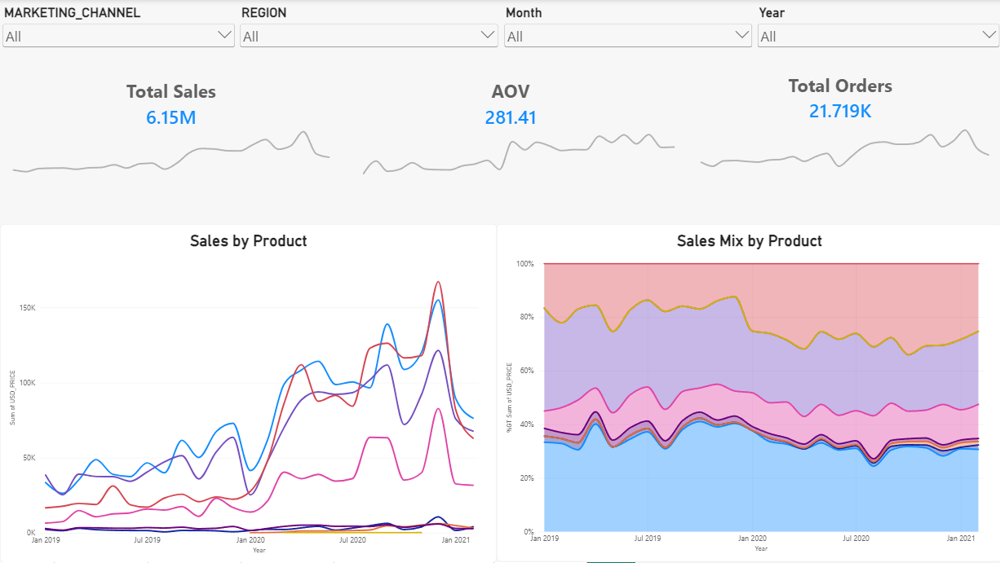
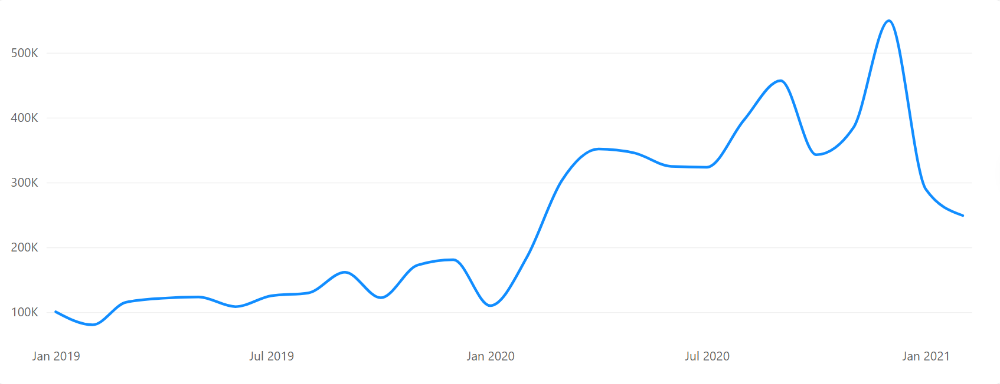
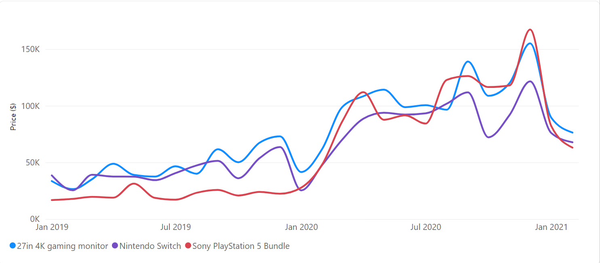
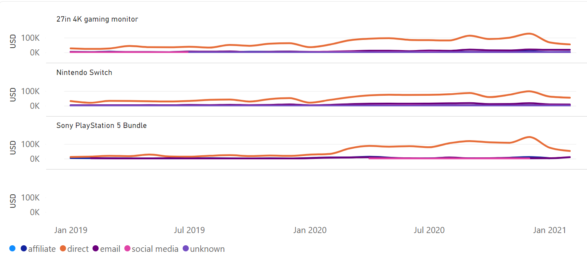
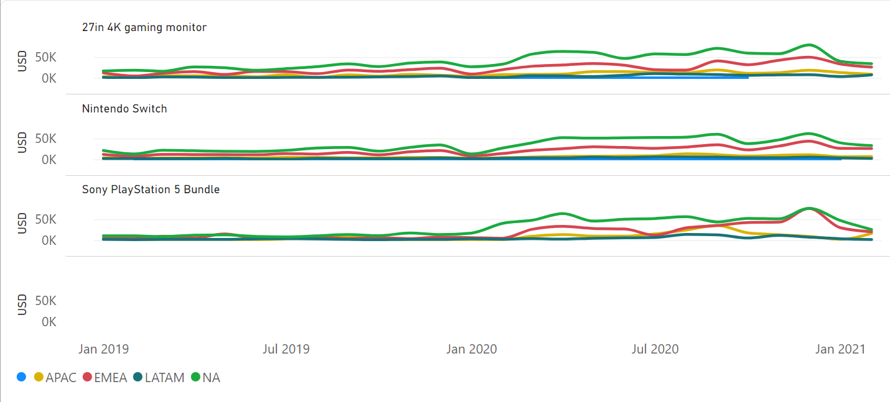
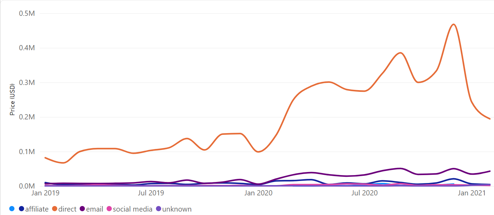
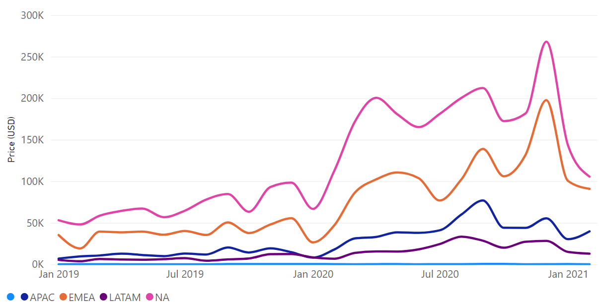

# Client Background

**GamerGear Digital**
GamerGear Digital is a global online retailer specializing in gaming and consumer electronics, selling popular products like Nintendo Switch consoles, PlayStation bundles, gaming monitors, and accessories.
With customers in 148 countries - concentrated in the US (47%), UK(8%), and Canada(4%) - the company processes tens of thousands of orders monthly trhough its website and mobile app.
GameGear competes on price, product selection, and customer experience in the fast-paced gaming hardware market.

**Insights and Recommendations are provided on the following areas.**
- **Overall Sales Performance** - Sales trends, growth patterns, and the early-2021 decline.
- **Product Performance** - Revenue concentration, top-performing products, and products driving the decline.
- **Marketing Channel Performance** - Sales contribution by channel
- **Regional Performance** - Geographic sales patterns and regional differences.

# Executive Summary
**Overview of Findings**

Sales reached **$6.15M** across **21.7K orders**, with an overall AOV of **$281.41**. Revenue was highly concentrated in the **4K Gaming Monitor, Nintendo Switch, and PS5,** which together generated about **84% of total sales.** Sales grew strongly throughtout 2020 before declining sharply in early 2021, with the largest products contributing most to the downturn. Further analysis shows the **PS5 decline was particularly concentrated in Direct-channel sales within North America**, making this segment the main area for investigation.

# Deep Dive Analysis

### Overall Sales Trends
Sales increased substantially throughout 2020, reaching major peaks around **September and December.** The business generated more than **$6M in total sales,** but performance declined noticeably at the beginning of 2021. Because January is the final period in the dataset, data completeness should be checked before treating the decline as a confirmed long-term trend.

### Product Performance
The **4K Gaming Monitor, Nintendo Switch, and PS5** dominate the product portfolio, contributing approximately **84% of total sales.** Their strong contribution also means changes in these products have a disproportionate effect on overall company performance. All three experienced weaker sales in early 2021, making them the primary products to investigate further.

**Product x Marketing Channel**
- Among the major products, **PS5 showed the most noticeable decline in Direct-channel sales** during early 2021.
- Other marketing channels did not display a decline of the same magnitude for the product. 
- This makes **PS5 x Direct** an important segment for further investigation into demand, inventory, pricing, or marketing changes.

**Product x Region**
- Further segmentation shows that much of the PS5 decline is concentrated in **North America.** Combining the regional and channel analysis points toward **PS5 x North America x Direct** as the most specific area associated with the downturn.
-  The next step should be to investigate operational or commercial factors affecting this segment rather than assuming the decline represents a company-wide issue.

### Marketing Performance
- **Direct** is the dominant marketing channel and generates substantially more sales than the other channels. Because of its large revenue contribution, changes in Direct sales can significantly affect total company performance.
- The early-2021 decline is particularly visible within Direct traffic, suggesting this channel should be investigated alongside product performance.

### Regional Performance
- Most regions show a similar decline around early 2021, indicating that the overall downturn is not limited to a single geographic market. 
- However, deeper segmentation reveals that some product-region combinations were affected more heavily than others.
- This suggests that proudct performance provides a more useful starting point for diagnosing the decline than region alone.

# Recommendations
1. **Investigate the PS5 sales decline in North America**
PS5 sales showed a notable decline in early 2021, particularly through the **Direct channel in North America.** 

2. **Protect performance of the three core revenue products**
The **4K Gaming Monitor, Nintendo Switch, and PS5 account for approximately 84% of total revenue.**
Priortize inventory availability, pricing monitoring, and performance tracking for these products because changes in their sales have the greatest impact on overall business performance.

3. **Validate Direct-channel attribution and test alternative channels**
Direct generates a disproportionately large share of sales compared with other marketing channels. Validate that traffic and sales are beign attributed correctly, then test targeted **Email Campaigns** for selected high-value products to determine whether the business can reduce its dependence on Direct traffic.

4. **Review low-performing headset products**
Headset products contribute less than 2% of overall revenue, making them relatively small contributors to the product portfolio. Review their profitability, inventory turnover, and strategic value to determine whether inventory should be reduced or resources reallocated toward higher-performing products.

# Assumptions and Caveats
**Historical dataset:** The analysis is based on past sales data and may not reflect current customer behavior, market conditions, product demand, or channel performance.

**January 2021 may be incomplete:** The sharp decline at the end of the dataset should not automatically be interpreted as a sustained business downturn, as January 2021 may represent a partial reporting period.

**External and operational drivers are not captured:** Factors such as inventory shortages, pricing changes, competitor activity, supply constraints, and marketing campaign spend may have influenced sales but are not available in the dataset.
